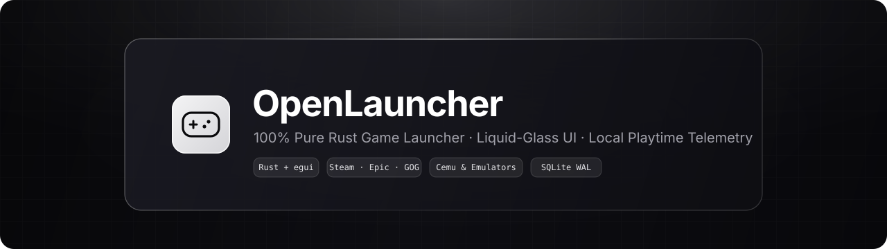

<div align="center">



# OpenLauncher

**A fast, 100% pure Rust desktop game launcher with a monochrome Liquid-Glass UI, automatic store & emulator discovery, and local SQLite playtime tracking.**

[](https://www.rust-lang.org/)
[](https://github.com/emilk/egui)
[](https://www.sqlite.org/)
[](https://github.com/Lukas-eft/OpenLauncher)

</div>

---

## ✨ Features

- **100% Native Rust Desktop App** — Built directly with `eframe` / `egui` without any WebView, Electron, Node.js, or browser overhead.
- **Black & Gray Liquid-Glass Design** — Borderless translucent-style obsidian surfaces, crisp vector icons, subtle specular borders, and responsive 2:3 cover grid.
- **Automatic Store & Library Discovery** — Scans and imports games from:
  - **Steam** (parses `libraryfolders.vdf` / `appmanifest_*.acf`, resolves local `appcache/librarycache` covers & hero banners before CDN fallback)
  - **Epic Games Store** (reads `.item` manifests, extracts `DieselGameBoxTall` covers & `DieselGameBox` banners from `catcache.bin`, launches via `com.epicgames.launcher://`)
  - **GOG Galaxy** (reads Windows Registry entries)
  - **Minecraft** (detects **Minecraft Launcher** / Java Edition & **Minecraft for Windows** Bedrock UWP packages with logos and `shell:AppsFolder` launch)
- **First-Class Emulator Support** — Built-in presets for **Cemu**, **Dolphin**, **RPCS3**, **PCSX2**, **Ryujinx**, **Yuzu / Eden**, **PPSSPP**, **DuckStation**, **Citra / Azahar**, and **mGBA**:
  - Auto-detects emulator executables, Cemu `settings.xml` / `games` / `mlc01` paths, and `meta.xml` titles
  - Skips Wii U updates/DLCs (`0005000e` / `0005000c`) and automatically converts Cemu `.tga` cover art (`bootTvTex.tga` / `iconTex.tga`) to managed `.png` covers
- **Background Playtime Telemetry** — Tracks active game processes (including child/handoff processes and store URI launches) and persists sessions in SQLite (`WAL` mode).
- **Quick Search (`Ctrl+K`) & System Tray** — Fuzzy command palette with keyboard navigation (`↑↓`, `Enter`, `Shift+Enter`) and optional minimize-to-tray so playtime tracking stays active.

---

## 🎮 Supported Platforms & Emulators

| Category | Sources / Presets | Cover Resolution |
| :--- | :--- | :--- |
| **PC Stores** | Steam, Epic Games, GOG Galaxy, Minecraft | Local Steam `librarycache`, Epic `catcache.bin`, UWP logos, nearby `cover.*` |
| **PC Folders** | Custom folders (`D:\Games`, `.desktop`, Unreal `Binaries/Win64`) | Nearby `cover.*` / `boxart.*` / `poster.*` |
| **Emulators** | Cemu, Dolphin, RPCS3, PCSX2, Ryujinx, Yuzu/Eden, PPSSPP, DuckStation, Citra/Azahar, mGBA | Cemu `meta/*.tga` (auto-converted to PNG), nearby cover files |

---

## 🚀 Getting Started

### Prerequisites

- [Rust](https://rustup.rs/) (stable toolchain, edition 2021)
- Windows 10/11 (recommended) or Linux

### Build & Run

```bash
# Clone the repository
git clone https://github.com/Lukas-eft/OpenLauncher.git
cd OpenLauncher

# Run unit tests
cargo test

# Run linter
cargo clippy --all-targets -- -D warnings

# Build optimized release binary
cargo build --release
```

The compiled executable will be at:

```text
target/release/openlauncher.exe
```

---

## 🗂️ Architecture

```text
src/
├── main.rs            # Borderless eframe viewport bootstrap & Windows DWM styling
├── app.rs             # Application state, async workers, file dialogs & modal routing
├── db.rs              # SQLite schema, CRUD, bulk import, tags & play_sessions (WAL)
├── discovery.rs       # Epic/GOG/Minecraft/PC folder & emulator ROM/executable scanning
├── steam.rs           # VDF/ACF parser & local Steam librarycache asset resolver
├── covers.rs          # Managed cover storage, TGA->PNG conversion & URI resolution
├── launcher.rs        # Safe process, Steam, Epic URI & shell:AppsFolder launching + tracker
├── fuzzy.rs           # Fuzzy search scoring for the Ctrl+K command palette
├── tray.rs            # System tray icon, context menu & Win32 window restore
├── theme.rs           # Black/Gray Liquid-Glass color palette & surface helpers
└── ui/                # Titlebar, Sidebar, TopBar, GameGrid, DetailModal, Forms, Settings
```

---

## 📄 License

This project is open source. See the repository for details.
